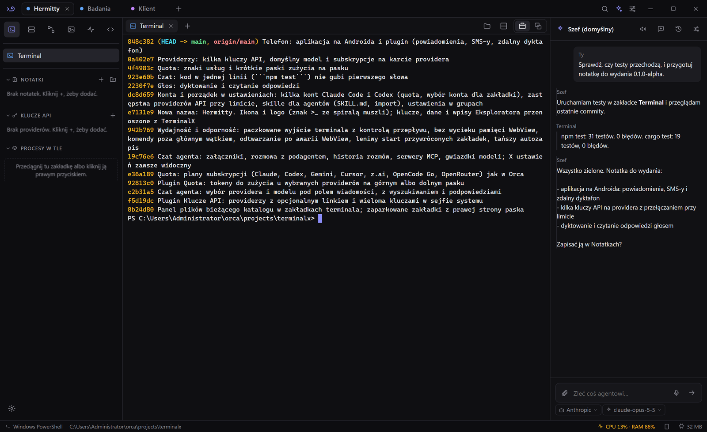
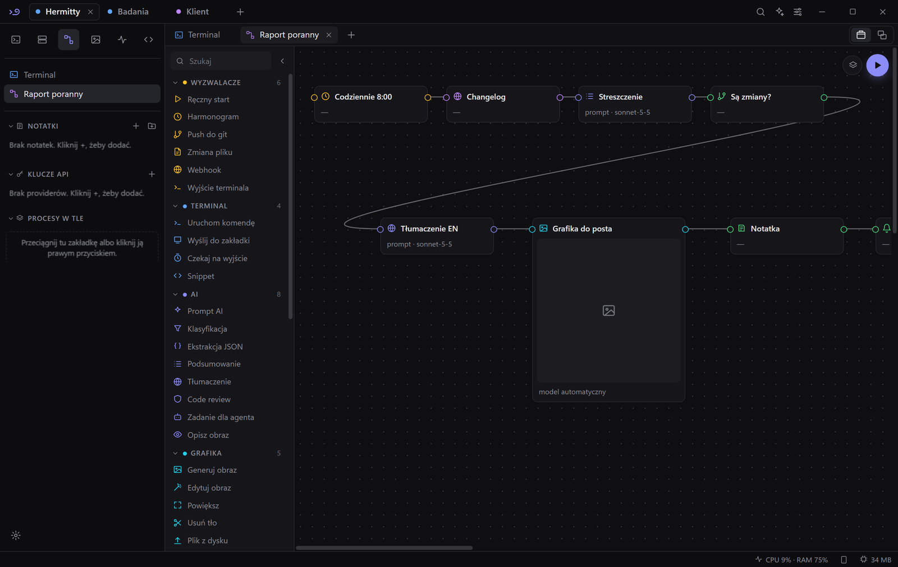
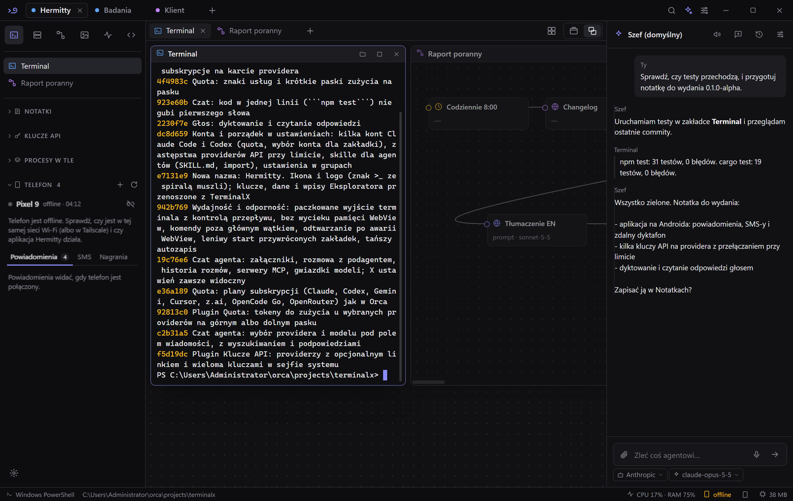
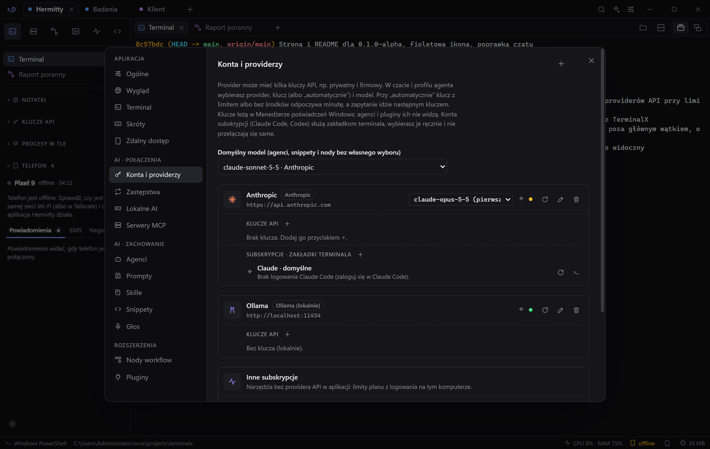
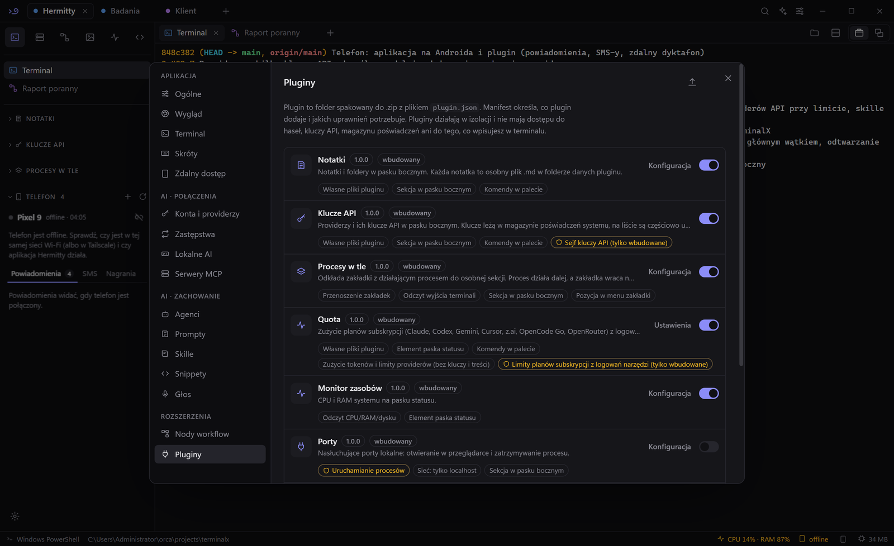
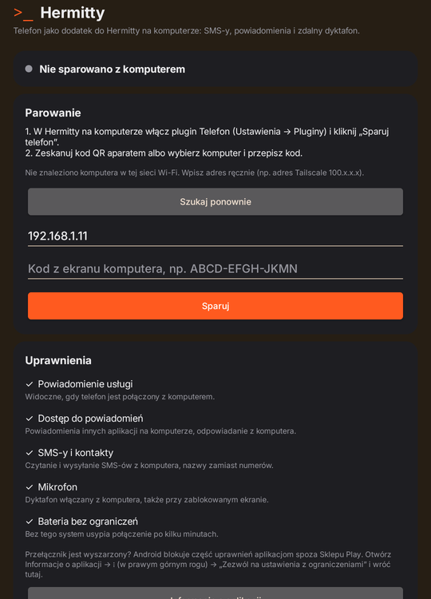
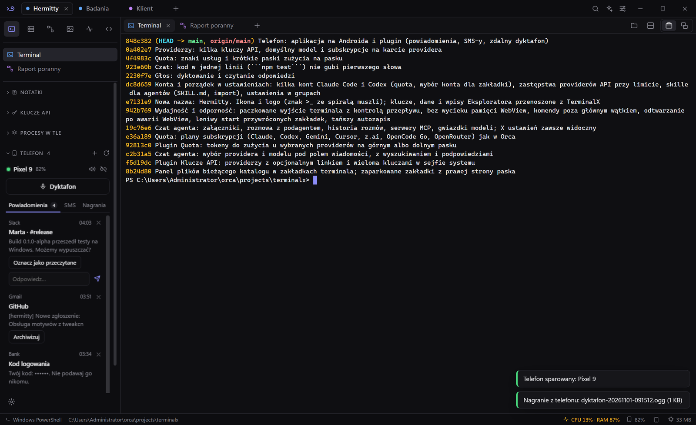

<p align="center"></p>

<h1 align="center">Hermitty</h1>

<p align="center"><b>Terminale, agenci AI i workflow w jednym lekkim oknie. Do tego telefon z Androidem przy komputerze.</b></p>

<p align="center">
  <a href="https://github.com/JogiFPV2/terminalx/releases/tag/v0.1.0-alpha"><b>Pobierz 0.1.0-alpha</b></a> ·
  <a href="https://jogifpv2.github.io/terminalx/">Strona</a> ·
  <a href="docs/FUNKCJE.md">Wszystkie funkcje</a> ·
  <a href="docs/PLUGINS.md">Pluginy dla twórców</a>
</p>

> [!WARNING]
> **To jest wersja alpha.** Hermitty jest we wczesnych testach i może zawierać błędy. Nie powierzaj jej jeszcze krytycznej pracy. Błędy i pomysły zgłaszaj w [Issues](https://github.com/JogiFPV2/terminalx/issues).



## Co to jest

Hermitty to aplikacja na Windows: menedżer terminali z wbudowanym asystentem AI. Pracujesz w workspace'ach z zakładkami (PowerShell, CMD, WSL, SSH). Każdy workspace ma agenta, który czyta terminale, uruchamia komendy za Twoją zgodą i zleca zadania podagentom w zakładkach. Instalator ma ok. 3 MB, a uruchomiona aplikacja z jednym terminalem zajmuje ok. 95 MB RAM.

| | |
|---|---|
| **Terminale i workspace'y** | Zakładki z drag & drop, podział paneli, tryb „Okna” z przyciemnianiem nieaktywnych, panel plików, zamykanie z 20-sekundowym cofnięciem. |
| **Agent i podagenci** | Agent na workspace, podagent na zakładkę, uprawnienia (tylko odczyt / pytaj / automatycznie), załączniki, historia rozmów, serwery MCP, skille. |
| **Workflow** | 50 nodów w 10 kategoriach: terminal, AI, grafika, wideo, logika, pliki, sieć. Wyzwalacze cron, git i zmiana pliku. Agent buduje workflow z opisu. |
| **Lokalne AI** | Grafika i wideo na własnej karcie przez ComfyUI (instalacja jednym kliknięciem, gotowe modele), Ollama, wspólna kolejka GPU. |
| **Głos** | Dyktowanie wiadomości do agenta i czytanie odpowiedzi na głos. |
| **Konta i providerzy** | Anthropic, OpenAI, Google, OpenRouter, Ollama i inne, a także zainstalowane CLI (Claude Code, Codex, Gemini CLI, Amp, OpenCode, Cursor…) z ich własnym logowaniem. Kilka kluczy na providera z przełączaniem przy limicie, zastępstwa między providerami, limity planów subskrypcji. Klucze leżą w Menedżerze poświadczeń Windows. |
| **SSH i SFTP** | Vault hostów, klucze, agent SSH, przekierowania portów, dwupanelowy SFTP. |
| **Pluginy** | Izolowane w sandboxie, z jawnymi uprawnieniami. Każdy plugin do pobrania osobno (niżej). |

<table>
  <tr>
    <td></td>
    <td></td>
  </tr>
  <tr>
    <td></td>
    <td></td>
  </tr>
</table>

## Hermitty na Androida



Mała aplikacja (ok. 90 KB) łączy telefon z Hermitty na komputerze. Obsługujesz ją z paska bocznego (plugin **Telefon**):

- **Powiadomienia** z telefonu na komputerze: odpowiadasz (np. w komunikatorach) i zamykasz je bez sięgania po telefon.
- **SMS-y**: lista rozmów, czytanie i wysyłanie.
- **Zdalny dyktafon**: nagrywanie włączasz z komputera (Ctrl+Alt+R), także przy zablokowanym ekranie. Nagranie trafia na komputer, gdzie odsłuchasz je albo zamienisz na tekst.
- **Znajdź telefon** (dzwonek na pełnej głośności) i **bateria** w pasku statusu.

**Bezpieczeństwo.** Połączenie jest szyfrowane (AES-256-GCM) kluczem z jednorazowego parowania. Kody logowania i BLIK telefon zamienia na kropki, zanim cokolwiek wyśle. Pluginy innych autorów nie mają dostępu do telefonu.

**Wymagania:** Android 10 lub nowszy, telefon i komputer w tej samej sieci Wi-Fi albo w [Tailscale](https://tailscale.com).

**Instalacja:** pobierz plik APK z [wydania](https://github.com/JogiFPV2/terminalx/releases/tag/v0.1.0-alpha) i otwórz go na telefonie. Potem w Hermitty: Ustawienia → Pluginy → włącz **Telefon** → w pasku bocznym kliknij **+** i wpisz kod w aplikacji. Aplikacja przeprowadzi Cię przez uprawnienia. Jeśli przełącznik jest wyszarzony: Informacje o aplikacji → ⋮ → „Zezwól na ustawienia z ograniczeniami”.

<br clear="right">



## Pobieranie

Wszystkie pliki są w wydaniu [**v0.1.0-alpha**](https://github.com/JogiFPV2/terminalx/releases/tag/v0.1.0-alpha).

| Plik | Opis |
|---|---|
| [Hermitty-0.1.0-alpha-setup.exe](https://github.com/JogiFPV2/terminalx/releases/download/v0.1.0-alpha/Hermitty-0.1.0-alpha-setup.exe) | Instalator dla Windows 10/11 (aktualizuje się sam) |
| [Hermitty-0.1.0-alpha-portable.exe](https://github.com/JogiFPV2/terminalx/releases/download/v0.1.0-alpha/Hermitty-0.1.0-alpha-portable.exe) | Wersja bez instalacji |
| [Hermitty-Telefon-0.1.0-alpha.apk](https://github.com/JogiFPV2/terminalx/releases/download/v0.1.0-alpha/Hermitty-Telefon-0.1.0-alpha.apk) | Aplikacja na Androida |

Instalator nie ma jeszcze certyfikatu, więc Windows SmartScreen pokaże ostrzeżenie. Wybierz „Więcej informacji” → „Uruchom mimo to”.

### Pluginy

Pluginy są już w aplikacji. Osobne paczki służą do ponownej instalacji albo aktualizacji przez Ustawienia → Pluginy → Importuj. Plugin oznaczony 🔒 korzysta z uprawnień dostępnych tylko wbudowanym pluginom (sejf kluczy, logowania narzędzi, telefon), więc działa wyłącznie w wersji dostarczonej z aplikacją.

| Plugin | Co robi | Pobierz |
|---|---|---|
| Notatki | Notatki i foldery w pasku bocznym, każda notatka w osobnym pliku `.md` | [zip](https://github.com/JogiFPV2/terminalx/releases/download/v0.1.0-alpha/tx.notes-1.0.0.zip) |
| Procesy w tle | Odkładanie zakładek z działającym procesem do paska bocznego | [zip](https://github.com/JogiFPV2/terminalx/releases/download/v0.1.0-alpha/tx.bcgrnd_process-1.0.0.zip) |
| Monitor zasobów | CPU i RAM na pasku statusu | [zip](https://github.com/JogiFPV2/terminalx/releases/download/v0.1.0-alpha/tx.sysmon-1.0.0.zip) |
| Porty | Lista zajętych portów z procesami | [zip](https://github.com/JogiFPV2/terminalx/releases/download/v0.1.0-alpha/tx.ports-1.0.0.zip) |
| Pomodoro | Licznik pracy i przerw | [zip](https://github.com/JogiFPV2/terminalx/releases/download/v0.1.0-alpha/tx.pomodoro-1.0.0.zip) |
| Klucze API 🔒 | Providerzy i klucze z sejfu systemu, kopiowanie jednym kliknięciem | [zip](https://github.com/JogiFPV2/terminalx/releases/download/v0.1.0-alpha/tx.keys-1.0.0.zip) |
| Quota 🔒 | Zużycie planów (Claude, Codex, Gemini, Cursor…) i limitów API z paskami | [zip](https://github.com/JogiFPV2/terminalx/releases/download/v0.1.0-alpha/tx.quota-1.0.0.zip) |
| Telefon 🔒 | Powiadomienia, SMS-y i dyktafon z telefonu z Androidem | [zip](https://github.com/JogiFPV2/terminalx/releases/download/v0.1.0-alpha/tx.phone-0.1.0.zip) |

Własne pluginy: [docs/PLUGINS.md](docs/PLUGINS.md) i typy w [plugins/sdk](plugins/sdk/hermitty-plugin.d.ts).

## Budowanie ze źródeł

```powershell
npm install
npm run app:dev       # tryb deweloperski
npm run app:build     # wersja release + instalator NSIS
npm run plugins:pack  # pluginy → release/plugins/*.zip
npm test

cd android; ./gradlew assembleRelease   # APK (podpis: android/keystore.properties)
```

Wymagania: Node.js 20+, Rust (toolchain MSVC), Visual Studio Build Tools („Desktop development with C++”). Do APK: JDK 17 i Android SDK 36. Paczki aktualizacji podpisuje klucz `TAURI_SIGNING_PRIVATE_KEY`.

Linux i macOS: kod jest przenośny (Tauri 2), ale wersje alpha są budowane i testowane tylko na Windows.

## Struktura

```
src/                 interfejs (Svelte 5)
  lib/terminal/      sesje xterm.js + PTY
  lib/plugins/       host pluginów i środowisko w iframe
  lib/workflow/      edytor i silnik workflow, przepisy modeli (presets.ts), ComfyUI, budowanie przez agenta
  lib/gpu.ts         kolejka GPU (ComfyUI + Ollama)
  lib/i18n/          słowniki tłumaczeń
  lib/components/    widoki, ustawienia
src-tauri/src/       rdzeń w Ruście: pty.rs, sys.rs, store.rs, ai.rs, media.rs, local.rs (ComfyUI, pobieranie, sprzęt), monitor.rs, ssh.rs, remote.rs, phone.rs
catalog/             katalog modeli lokalnych pobierany przez aplikację
tests/               testy (npm test)
.github/workflows/   CI i wydania
plugins/             wbudowane pluginy + sdk/hermitty-plugin.d.ts
android/             aplikacja na Androida (Kotlin, bez bibliotek)
site/                strona hermitty.mypinsy.com
docs/PLUGINS.md      specyfikacja pluginów
PLAN.md              plan i architektura
```
